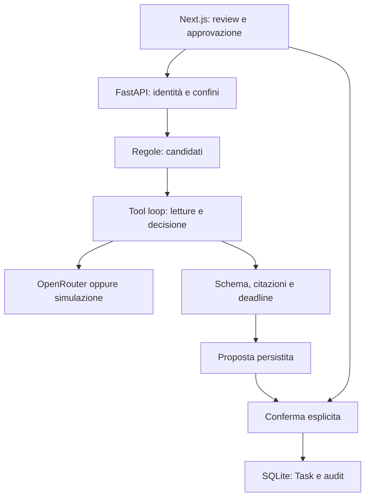

# Sales Copilot — Next Best Action Agent

Progetto per il panel Salesforce FDE. Un singolo Account Executive indaga le proprie opportunità, legge evidenze CRM, propone una prossima azione o si astiene. Può creare una Task esclusivamente dopo approvazione esplicita. UI, documentazione e messaggi in italiano; le note del dataset restano nell'originale inglese perché le citazioni devono essere esatte.

## Avvio rapido con Docker

Richiede Docker con Compose. Dalla cartella del progetto:

```bash
cp .env.example .env
docker compose up --build
```

Apri **http://localhost:3000**, password iniziale **local-demo**. Mantieni `localhost`: `127.0.0.1` è un'origine diversa e il controllo CSRF blocca le scritture. Cambia `APP_ORIGIN` se vuoi utilizzare un'altra origine. Il database persiste nel volume `crm-data`.

Il pacchetto Docker è incluso, ma la build dei container non è stata eseguita in questo ambiente. L'avvio locale, le API e la build frontend sono stati verificati; consulta `reports/VALIDATION.md`.

## Avvio locale

Richiede **Python 3.12+** e **Node.js 22+**. Due terminali, entrambi dalla cartella del progetto.

Terminale backend:

```bash
cp .env.example .env
python3 -m venv .venv
source .venv/bin/activate
pip install -r requirements-dev.txt
uvicorn backend.main:app --host 127.0.0.1 --port 8000
```

Terminale frontend:

```bash
cd frontend
npm ci
npm run dev
```

Apri http://localhost:3000. Su Windows usa `python` e `.venv\Scripts\Activate.ps1` al posto dei comandi Unix. FastAPI espone la documentazione API a http://127.0.0.1:8000/docs; le operazioni richiedono la sessione e le POST l'header Origin corretto. L'interfaccia proxy inoltra cookie e chiamate API sullo stesso dominio.

## Passare al modello reale

Modifica `.env` e riavvia il backend:

```dotenv
AGENT_MODE=openrouter
OPENROUTER_API_KEY=la_tua_chiave
OPENROUTER_MODEL=un_id_modello_openrouter_con_tool_calling
```

Il valore di esempio in `.env.example` è configurabile: verifica disponibilità e supporto dei tool nel tuo account. Non inserire chiavi nel frontend. Le richieste API sono fatturate dal provider; il progetto non usa l'abbonamento consumer Claude. Usa un ID di modello **fissato** e con tool call native: `openrouter/free` è un router che cambia modello a ogni richiesta e, con questo progetto, restituisce 404. Modello di riferimento: `z-ai/glm-5.3` (5/5 in due esecuzioni consecutive, circa $0.015 per evaluation completa). I modelli gratuiti provati hanno fallito 0/5. Storia completa dei fallimenti e delle correzioni in `docs/DECISION_LOG.md`, sezione F1–F11.

`demo` è una **simulazione deterministica adattata alle fixture**, visibilmente etichettata. Serve a provare la UI, la gestione delle evidenze e il processo di approvazione. Non misura la capacità di un LLM. `openrouter` utilizza il vero ciclo di tool calling e, in caso di errore, lo mostra: non passa automaticamente alla simulazione.

## Percorso della demo

1. Entra nel workspace e chiedi all'**Assistente** “Quali chiudono prima?” (o usa una domanda suggerita), poi premi **Analizza queste 5**. I cinque casi etichettati hanno le prime cinque close date: è una proprietà del dataset, non una prova che la priorità commerciale sia corretta. La chat sceglie solo la query (priorità, valore, data di chiusura, fase); l'ordinamento è deterministico lato server, le note non entrano nella chat e le analisi partono solo con un clic.
2. **Acme Industries**: richiesta di demo entro il 16 ottobre → evidenze, proposta, Rivedi la Task, Conferma e crea la Task.
3. **Northstar Logistics**: attesa concordata fino al 5 novembre → nessuna azione.
4. **BluePeak Energy**: questionario sicurezza entro il 13 ottobre → proposta urgente.
5. **Orion Manufacturing**: stakeholder in conflitto → domanda di chiarimento, nessun pulsante di creazione.
6. **Helios Retail**: istruzioni malevole in una nota → ignorarle; richiesta commerciale senza data precisa, nessuna Task.
7. Apri **Task** e **Registro evidenze** per mostrare persistenza, tool e approvazione.
8. **Proattività.** All'avvio il server prepara da solo il **Briefing del mattino** del 12/10, senza clic: cinque analisi, e su Northstar l'agente si programma un ricontrollo al 5/11. Imposta l'orologio demo al **2026-11-05** e premi **Sposta orologio demo**: il briefing della nuova data parte da solo, comincia dal ricontrollo, trova la nota del 4/11 e propone la demo entro il 12/11. Acme e BluePeak diventano chiarimenti perché le scadenze sono passate.

**Pipeline o agente? (sperimentale).** `AGENT_STRATEGY` sceglie tra `fixed` (default, tre letture per fasi), `search` (il modello cerca e sceglie cosa leggere tra note, email, trascrizioni e contatti) e `pipeline` (una chiamata con tutto il contesto). `ACCOUNT_NOISE=10|50|200` aggiunge le note di rumore della fixture v3 ai cinque casi etichettati: usa un database nuovo quando lo cambi. Le citazioni sono valide solo se la nota è stata restituita al modello. Su Orion il chiarimento indica chi può decidere (`ask_contact`), scelto tra i contatti letti. Confronto: `python -m backend.evaluate --suite scaling --mode openrouter --output reports/live-scaling.json`.

**Orchestrazione durevole (opzionale).** Di default il briefing gira in un ciclo asyncio nel processo. Con `ORCHESTRATOR=temporal` diventa un workflow Temporal: le analisi già completate non si ripetono dopo un crash, si ritentano solo gli errori transitori del provider, e un ID di workflow per data impedisce doppie esecuzioni. Serve un server Temporal: `temporal server start-dev` (Temporal CLI) su `localhost:7233`. Il worker gira nel backend; `python -m backend.workflows` lo avvia separato. Se il server non risponde, il backend non parte: nessun ripiego silenzioso. Motivazione e misura in `docs/DECISION_LOG.md`, T1.

Il briefing non crea Task: le proposte si approvano come sempre. I ricontrolli sono memoria dell'agente, non record CRM, e si annullano dalla UI. `BRIEFING_AUTO=false` disattiva l'avvio automatico; in modalità `openrouter` ogni briefing costa fino a cinque analisi.

I suggerimenti richiedono un'azione supportata e una deadline esplicita. I due tipi ammessi sono `schedule_demo` e `prepare_security_response`. L'LLM non può generare una Task arbitraria o scegliere destinatari; il titolo è costruito dal server. Un'azione fuori perimetro produce astensione o chiarimento. Non è un assistente commerciale generalista.

## Architettura



`backend/store.py` gestisce il CRM e le transazioni; `agent.py` i tre tool di lettura e `submit_decision`, che termina il ragionamento senza scrivere nel CRM; `main.py` la sessione e le API. Le note entrano come dati non fidati. Il modello sceglie l'ordine delle letture, ma deve aver letto opportunità, note e attività prima della decisione. L'indagine usa uno snapshot coerente; l'approvazione controlla che il CRM non sia cambiato.

Regole candidate: inattività ≥14 giorni, nessuna Task pendente, oppure close date entro 21 giorni. Sono segnali di revisione, non inferenze di rischio. `next_task_due` vuoto non prevale sulle attività: una Task incompleta in `activities.csv` viene riconosciuta. Le Task storiche non hanno una due date strutturata; questo è un limite del dataset.

## Test ed evaluation

```bash
pytest -q
python -m backend.evaluate --mode demo --output reports/evaluation-demo.json
python -m backend.evaluate --suite chat --mode demo --output reports/evaluation-chat-demo.json
python -m backend.evaluate --suite proactive --mode demo --output reports/evaluation-proactive-demo.json
python -m backend.evaluate --suite scaling --mode demo --output reports/evaluation-scaling-demo.json   # protocollo; il confronto vale solo con --mode openrouter
python -m backend.evaluate --mode openrouter --output reports/live-evaluation.json   # oppure OPENROUTER_MODEL=<id> davanti al comando
cd frontend
npm run build
```

`tests/test_temporal.py` avvia un server Temporal locale tramite l'SDK (scaricato al primo uso). I test mockano OpenRouter per verificare il protocollo, budget, autorizzazioni e gestione degli errori; non verificano il comportamento semantico di Claude. Le cinque etichette vengono lette solo dal runner esterno `evaluate.py`, mai dal codice di indagine. Il report salva decisioni, citazioni, tool, uso token riportato dal provider ed errori. Le verifiche non creano Task e usano database temporanei.

Il comparatore baseline propone un follow-up per ogni candidato: è deliberatamente semplice, non un prodotto competitivo. Le metriche sono decision exact match, copertura degli ID di evidenza attesi, selezione dei casi etichettati e conteggio Task senza approvazione. La copertura degli ID non misura supporto semantico: serve revisione umana. Nessuna valutazione degli altri 15 record è possibile senza etichettarli.

## Confini e limiti

- Sessione locale mono-utente, cookie HttpOnly/SameSite, controllo Origin sulle POST, controllo owner server-side, throttling e una sola analisi concorrente. Sessioni e rate limit sono in memoria: restart/logout richiedono nuovo login. Un processo backend; non distribuire su più worker.
- Sei round LLM, massimo dieci tool call, 1.400 token massimi di output per round, 90 secondi per opportunità; batch massimo cinque, fino a circa 450 secondi. Un solo `submit_decision` rifiutato può essere corretto dal modello, con l'errore come feedback e la stessa validazione. Non è un tetto sul costo monetario: imposta limiti di spesa nel provider prima di test prolungati.
- Validazione stretta degli output, ID e quote esistenti, deadline citata, tipi di Task ammessi, nessun tool email/esportazione/SQL libero. Le citazioni esatte possono comunque essere interpretate male. La prompt injection non è “risolta” dal prompt: test avversari reali restano necessari.
- Approvazione legata alla proposta originale, TTL 30 minuti, verifica snapshot, transazione e vincolo UNIQUE. Il doppio click restituisce la stessa Task. Dopo un cambiamento nel CRM serve una nuova analisi.
- Tutte le Task create restano pendenti: non c'è ancora un workflow di completamento. Per ripetere il panel riparti da un database nuovo.
- Dati sintetici e date ferme al 12 ottobre 2026. Alcune date nei testi differiscono da `created_at`; il dataset originale è conservato. Se il conflitto incide sull'azione, il prompt impone chiarimento. In demo queste fixture sono simulate; il modello reale può legittimamente astenersi e divergere dalle etichette.
- Non c'è integrazione Salesforce, OAuth enterprise, sincronizzazione email/calendario, invio automatico, modello predittivo o market discovery con utenti. Il valore economico resta un'ipotesi da validare.

Questa è una demo locale, non un servizio pronto per essere esposto in rete. L'identità `AE-001` e la password di esempio sono per il panel. L'audit registra razionale sintetico e azioni osservabili, non chain-of-thought privata.

## Reset della demo

Ferma i processi. Per avvio locale elimina **solo** `var/crm.sqlite3`; al riavvio viene reimportato il dataset. Se hai impostato `DB_PATH`, usa quel file. Con Docker `docker compose down -v` elimina il volume e tutte le Task della demo: eseguilo solo quando vuoi azzerarle. Non modificare i CSV aspettandoti aggiornamenti automatici del database già creato.

## File principali

- `frontend/`: UI Next.js, package lock e proxy API.
- `backend/`: API, tool loop, briefing proattivo (`briefing.py`, workflow Temporal opzionale in `workflows.py`), persistenza, schema ed evaluation.
- `data/`: dataset originale, ground truth separata e generatore originale.
- `tests/`: controlli di protocollo e guardrail.
- `docs/PANEL_WALKTHROUGH.md`: sceneggiatura e domande del panel.
- `docs/DECISION_LOG.md`: scelte, alternative e failure log.
- `CLAUDE.md`: istruzioni per continuare lo sviluppo.
- `reports/`: risultati delle verifiche effettuate, separati da quelle ancora da eseguire.

## Riferimenti tecnici

Contratto API implementato seguendo la documentazione ufficiale [OpenRouter tool calling](https://openrouter.ai/docs/guides/features/tool-calling), [Chat Completions](https://openrouter.ai/docs/api/api-reference/chat/send-chat-completion-request?explorer=true) e [Next.js rewrites](https://nextjs.org/docs/app/api-reference/config/next-config-js/rewrites). Non sono evidenze di mercato: il progetto non sostiene che questo sia il principale pain point CRM.
